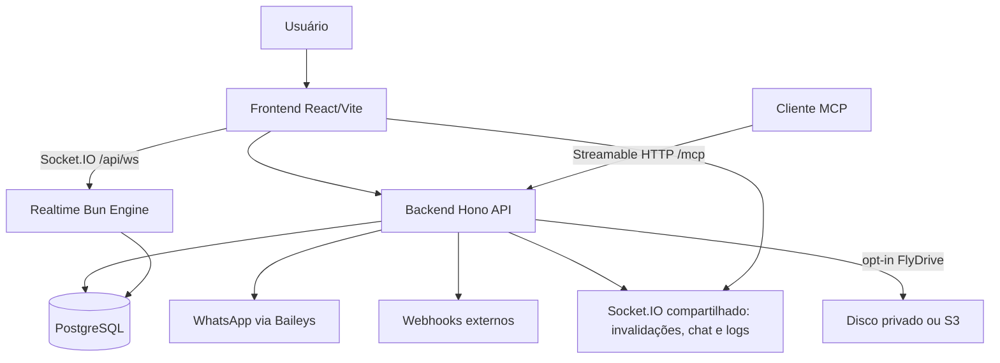

# Arquitetura

O Zappaz Lite é uma aplicação full-stack formada por um backend Hono/Prisma e um frontend React/Vite.



## Backend

Local: `server/`. O backend roda com Bun e compartilha o pacote e lockfile da raiz com o frontend.

`Bun.serve` recebe HTTP/upgrade e encaminha `/api/ws` ao Engine.IO antes do Hono. `realtime/` autentica assinaturas e publica DTOs após commit, revalidando acesso antes de emitir. Eventos não são replay durável; snapshots REST recuperam o estado. `WaContact`, `WaConversation`, `WaMessage` e `WaMessageMedia` isolam dados por sessão/conversa. Thumbnail validada fica no banco independentemente da persistência de arquivo. FlyDrive é desativado por padrão; quando ativo usa FS ou S3 privado.

Responsabilidades principais:

- autenticação;
- gerenciamento de usuários;
- gerenciamento de sessões WhatsApp;
- envio de mensagens;
- configuração de webhooks;
- persistência em PostgreSQL;
- publicação de eventos/logs em tempo real.
- ferramentas MCP de mensagens, grupos e webhooks, autenticadas por sessão e executadas pelos mesmos serviços no mesmo processo Hono (SDK oficial v2).

Estrutura principal:

```text
server/src/
├── app.ts
├── common/
├── db/
├── lib/
├── middleware/
├── realtime/
└── modules/
```

## Frontend

Local: raiz do repositório (`src/`, `public/`, `vite.config.ts`).

Responsabilidades principais:

- interface administrativa;
- autenticação via cookie HttpOnly;
- listagem e operação de sessões;
- visualização de webhooks e logs;
- conexão Socket.IO compartilhada na área autenticada para invalidações, chat e logs.

Estrutura principal:

```text
src/
├── atoms/
├── components/
├── lib/
├── routes/
└── App.tsx
```

## Banco de dados

O backend usa PostgreSQL com Prisma ORM 7.8.0 (CLI, client e adapter alinhados; sem upgrade para v8). `docker/docker-compose.dev.yml` contém banco e Gateway locais; `docker/docker-compose.prod.yml` contém aplicação e banco para Dokploy, sem Gateway.

## Comunicação frontend/backend

- O frontend usa URLs relativas na mesma origem da API; o desenvolvimento usa proxy do Vite.
- Requisições autenticadas usam credentials/cookies.
- Logs em tempo real compartilham o Socket.IO da área autenticada, na mesma origem da API, sem variável de frontend. Consulte [Realtime](realtime.md).

Os contratos da [API de integração](api.md) são separados da documentação do [chat por domínio](chat/README.md): contatos, conversas, etiquetas, mensagens, mídias e realtime/sincronização. Os guias de frontend/backend descrevem a estrutura técnica, sem duplicar as regras de cada domínio.
