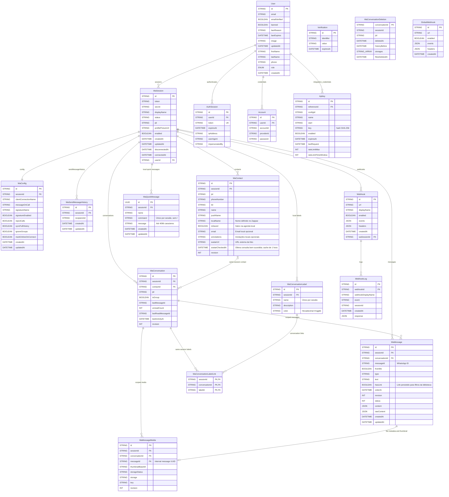

`WaConversationDeletion` é um recibo sem conteúdo de mensagens: impede restauração de histórico e permite repetir limpeza de arquivos. Não possui FK para conversa/sessão, pois precisa sobreviver às respectivas exclusões. Excluir `WaConversation` remove mensagens e mídias por cascade, mas preserva `WaContact`.

`WaConversationLabel` mantém o catálogo de etiquetas por sessão. `WaConversationLabelLink` permite várias etiquetas por conversa, com FKs compostas que impedem vínculos entre sessões. Excluir a etiqueta ou a conversa remove apenas os vínculos correspondentes por cascade; excluir uma conversa não exclui o catálogo de etiquetas. Contatos não recebem etiquetas.

`WaContact.phoneNumber` guarda o telefone em dígitos e `lid` guarda o JID `@lid`, com unicidades independentes por sessão. Ambos são opcionais; `jid` e os UUIDs permanecem estáveis ao enriquecer a identidade. Associações vêm apenas do payload WhatsApp; conflitos entre referências/históricos são rejeitados.

## Índices de consulta de mensagens

- `WaMessage(sessionId, orderAt, id)`: paginação cronológica de mensagens da sessão, sem filtro de conversa.
- `WaMessage(sessionId, conversationId, orderAt, id)`: paginação do histórico de uma conversa.
- `WaMessage(sessionId, messageId)` e a unicidade `(sessionId, conversationId, messageId)`: busca pelo ID WhatsApp dentro da sessão/conversa.
- `WaConversation(sessionId, contactId)`: localização das conversas do contato identificado por telefone, LID ou JID. Os identificadores de `WaContact` têm unicidade por sessão.
